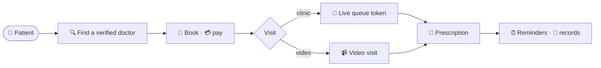

<h1 align="center">Hi, I'm Ram 👋</h1>
<h3 align="center">Founder @ Clinora · CSE student at NIT Srinagar · Aspiring Cybersecurity Engineer 🔐 · Python · DSA · Web Development</h3>

🌐 <a href="https://urstrulyrammukesh.github.io"><b>urstrulyrammukesh.github.io</b></a>

  
  
  
  
  
  

---

## 🧑‍💻 About me

- 🎓 B.Tech in **Computer Science & Engineering** at **National Institute of Technology (NIT) Srinagar**
- 🔐 **Aspiring Cybersecurity Engineer**: learning networking, Linux, web application security (OWASP Top 10) and Capture The Flag (CTF) challenges
- 🏥 **Founder & Developer of [Clinora](https://github.com/urstrulyrammukesh/clinora)**, a health platform to book real doctors, video visits, prescriptions, reminders, encrypted health records and a smart map with live location sharing · 🔍 [security-audited](https://github.com/urstrulyrammukesh/clinora/blob/main/docs/security-audit.md) with two-factor login · 📄 [Read the Clinora paper (PDF)](https://github.com/urstrulyrammukesh/clinora/blob/main/docs/Clinora-Company-Overview.pdf)
- 🌐 **[Clinora live demo](https://clinora-cwxu.onrender.com)** (free server: may take ~50 s to wake up)
- 🛠️ **[How Clinora is built](https://github.com/urstrulyrammukesh/clinora-tech-stack)**: languages, lines of code, APIs, database, tools and timeline
- 🧠 Practising **Data Structures & Algorithms** in Python, one problem at a time
- 🌱 Learning web development, system design and open source
- 🤝 Member of the **Training & Placement Cell**, NIT Srinagar
- 📍 Srinagar, Jammu & Kashmir, India

## 🏥 Clinora at a glance

  
  

## 🚀 Featured projects

| Project | Description | Stack |
|---------|-------------|-------|
| [**Clinora**](https://github.com/urstrulyrammukesh/clinora) · *Founder* | Health platform: book real doctors with online payment, video visits & printable prescriptions, reminders by push/SMS/WhatsApp, encrypted health records, clinic queues & teams, WhatsApp assistant, smart map with travel times & live location, 139 languages · security audit (9 fixes), 2FA, 45 tests, CodeQL | HTML · JavaScript · Python · AI |
| [**cybersecurity-journey**](https://github.com/urstrulyrammukesh/cybersecurity-journey) | My path into cybersecurity: networking, Linux and OWASP notes, lab log, CTF write-ups, a password strength checker and a security-headers grader | Python · Security |
| [**log-analyzer**](https://github.com/urstrulyrammukesh/log-analyzer) | Blue-team tool: finds brute force, scanners, SQL injection, XSS and Log4Shell in web & SSH logs, mapped to MITRE ATT&CK | Python · Security |
| [**Leetcode-**](https://github.com/urstrulyrammukesh/Leetcode-) | 233 LeetCode and DSA solutions in Python across 14 topics, each with its own tests (run by GitHub Actions) | Python |
| [**AlgoPulse**](https://github.com/urstrulyrammukesh/AlgoPulse) | Extending AlgoPulse with external IDE tools, GitHub syncing and hardware encryption | Python |

## 🛠️ Skills

- **Languages:** Python, Rust, HTML, CSS, JavaScript, TypeScript
- **Core CS:** Data Structures & Algorithms, Object-Oriented Programming
- **Security tools:** Nmap, Burp Suite, Wireshark, Linux, OSINT
- **Tools:** Git, GitHub, VS Code

## 🎓 Education

| | Details |
|---|---|
| 🎓 **B.Tech, Computer Science & Engineering** | National Institute of Technology (NIT) Srinagar |
| 🏆 **JEE Main** | 90.1 percentile |
| 📘 **Class 12** | 83.8% |
| 📗 **Class 10** | 71% |
| 💻 **Advanced Computer Course** | June 2022 to June 2023 |

## 🔐 Cybersecurity journey

I'm working towards a career in cybersecurity, and I track everything in **[cybersecurity-journey](https://github.com/urstrulyrammukesh/cybersecurity-journey)**. What I'm learning now:

- **Networking:** TCP/IP, DNS, HTTP and how traffic moves across the internet
- **Linux:** command line, permissions and shell scripting
- **Web security:** the OWASP Top 10 (SQL injection, XSS, broken authentication)
- **Practice:** Capture The Flag (CTF) challenges and hands-on security labs

## 🧩 LeetCode

I solve Data Structures & Algorithms problems on **[LeetCode](https://leetcode.com/u/urstrulyrammukesh96/)** in C++ and Python. My solutions with tests live in **[Leetcode-](https://github.com/urstrulyrammukesh/Leetcode-)**.

  

## 📊 GitHub stats

  
  

  

## 🤝 Connect with me

  
  
  
  
  
  

<i>Ram Mukesh Yadav · CSE @ NIT Srinagar · Aspiring Cybersecurity Engineer · always learning, always building</i>

